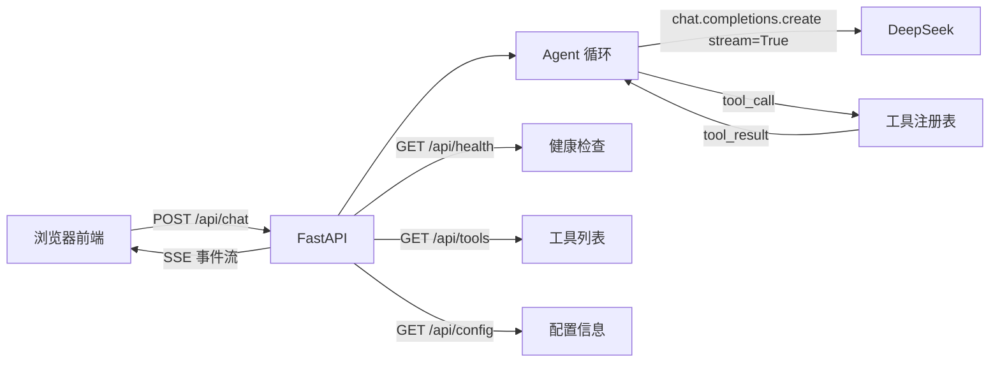
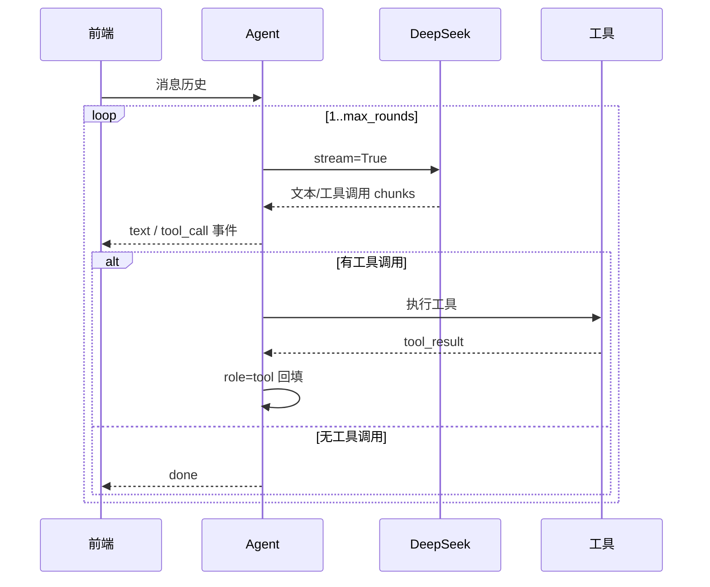

# countboter 开发文档

## 1. 项目简介

countboter 是一个最小的 AI Agent 示例，后端使用 Python FastAPI + Uvicorn，通过 OpenAI SDK 兼容接口对接 DeepSeek。前端使用原生 HTML/JS/CSS，通过 SSE 流式接收模型回复和工具调用过程。

项目核心目标：

- 模型可以调用工具，工具结果回填后继续下一轮。
- 默认最多执行 5 轮 Agent 循环。
- 保持代码简单、模块清晰、易于继续学习和扩展。
- 后端输出结构化日志，前端保留 SSE 事件日志，方便调试。
- 支持前端直接配置 API Key，并以加密方式保存。
- 支持多个会话，历史消息通过 SQLite 持久化。
- 每次功能更新都必须同步更新 `CHANGELOG.md`。

## 2. 技术栈

| 层级 | 技术 | 说明 |
| --- | --- | --- |
| 后端 | Python 3.11 | 当前使用 `E:\anaconda\envs\countbot` |
| Web 框架 | FastAPI + Uvicorn | 提供 REST 接口和 SSE 流式接口 |
| 模型 SDK | openai | 使用 OpenAI 兼容协议访问 DeepSeek |
| 配置 | python-dotenv | 支持 `.env` 与 `.env.example` |
| 数据校验 | Pydantic | 校验聊天请求和接口响应 |
| 加密 | cryptography | 使用 Fernet 加密 API Key |
| 持久化 | SQLite | 标准库 sqlite3，保存会话与消息 |
| 前端 | 原生 HTML/CSS/JS | 无构建工具，直接由 FastAPI 静态托管 |

## 3. 系统架构



整体调用顺序：

1. 前端把消息历史通过 `POST /api/chat` 发给 FastAPI。
2. FastAPI 创建 Agent，并以 SSE 流式返回事件。
3. Agent 调用 DeepSeek 流式接口，边读边转发文本片段。
4. 如果模型返回 `tool_calls`，Agent 执行对应工具，把结果以 `role=tool` 回填。
5. Agent 继续下一轮，直到模型不再调用工具或达到最大轮数。

## 4. 目录结构

```text
countboter/
├── backend/
│   ├── __init__.py       # Python 包标记
│   ├── app.py            # FastAPI 入口、静态托管、全局异常处理
│   ├── api.py            # REST 与 SSE 接口路由
│   ├── agent.py          # Agent 循环核心
│   ├── config.py         # 环境变量加载与配置对象
│   ├── db.py             # SQLite 数据库访问
│   ├── file_parser.py    # 上传文件解析
│   ├── harness.py        # 安全策略、工具审计和自检
│   ├── mcp/              # MCP Manager
│   ├── schemas.py        # Pydantic 请求/响应模型
│   ├── security.py       # API Key 加密与解密
│   ├── skills/           # 技能注册中心与内置技能
│   │   └── file_skill.py # 上传文件读取技能
│   └── tools.py          # 工具实现与注册表
├── tests/
│   └── test_harness.py   # Harness 单元测试
├── static/
│   ├── index.html        # 聊天页面
│   ├── app.js            # SSE 解析、事件渲染、工具卡片
│   └── style.css         # 样式与响应式布局
├── requirements.txt
├── .env.example
├── data/                 # 运行时自动创建，存放 countboter.db
├── run.bat
├── MCP_PLAN.md
├── CHANGELOG.md
├── README.md
└── DEVELOPMENT.md
```

## 5. 快速开始

当前机器直接使用 Conda 环境 `countbot`：

```bat
cd C:\Users\LNC\Desktop\countboter
E:\anaconda\envs\countbot\python.exe -m uvicorn backend.app:app --host 127.0.0.1 --port 8000
```

如果 8000 端口被占用，改用 8001：

```bat
E:\anaconda\envs\countbot\python.exe -m uvicorn backend.app:app --host 127.0.0.1 --port 8001
```

浏览器打开 `http://127.0.0.1:8000` 或 `http://127.0.0.1:8001`。

首次启动会自动创建 `data/countboter.db`。API Key 也可以不写在 `.env` 中，直接在页面右上角“设置”里填写，保存时会加密写入数据库。

## 6. 配置说明

后端只加载 `.env` 或系统环境变量，`.env.example` 仅作为模板，不参与运行配置。
前端保存设置后，数据库中的配置优先于环境变量。

| 环境变量 | 默认值 | 说明 |
| --- | --- | --- |
| `DEEPSEEK_API_KEY` | 无 | DeepSeek API 密钥，必须配置 |
| `DEEPSEEK_BASE_URL` | `https://api.deepseek.com/v1` | OpenAI 兼容接口地址 |
| `DEEPSEEK_MODEL` | `deepseek-chat` | 使用的模型名称 |
| `DEEPSEEK_MAX_ROUNDS` | `5` | Agent 最大循环轮数，最小为 1 |
| `DEEPSEEK_TOOL_TIMEOUT` | `10` | 单个工具执行超时时间，单位秒 |
| `APP_SECRET_KEY` | 自动生成 | Fernet 加密主密钥；未设置时自动生成并保存到 `.secret_key` |
| `LOG_LEVEL` | `INFO` | 日志级别：`DEBUG`、`INFO`、`WARNING` |
| `LOG_STREAM` | `1` | 是否输出模型 stream chunk；`0` 表示关闭 |
| `HARNESS_MODE` | `monitor` | 安全 Harness 模式：`monitor` 或 `enforce` |
| `HARNESS_ALLOWED_ROOTS` | 项目目录和 `data/` | 额外允许目录，分号分隔 |
| `HARNESS_MAX_FILE_SIZE` | `20971520` | 允许读取的最大文件字节数 |
| `MCP_SERVERS` | 空 | MCP Server 配置 JSON 列表 |

配置对象定义在 `backend/config.py`，接口层通过 `load_config()` 获取环境变量配置。如果数据库中存在前端保存的设置，接口会以数据库设置优先。

## 7. 后端模块说明

### 7.1 config.py

负责统一读取环境变量，返回不可变的 `AppConfig` 对象：

```python
@dataclass(frozen=True)
class AppConfig:
    api_key: str
    base_url: str
    model: str
    max_rounds: int
    tool_timeout: float
```

`load_config()` 会对 `DEEPSEEK_MAX_ROUNDS`、`DEEPSEEK_TOOL_TIMEOUT` 做基础校验，非法值时使用默认值并输出警告日志。

### 7.2 schemas.py

定义 Pydantic 模型，用于请求校验和响应约束：

- `ChatMessage`：单条消息，支持 `content`、`tool_calls`、`tool_call_id`。
- `ChatRequest`：`POST /api/chat` 请求体，包含 `session_id` 与 `message`。
- `SettingsRequest`：`PUT /api/settings` 请求体。
- `SessionCreateRequest`、`SessionRenameRequest`：会话创建与重命名请求体。
- `HealthResponse`：健康检查响应。
- `ConfigResponse`：非敏感配置信息，不包含 API Key。

### 7.3 tools.py

工具注册表包含两部分：

- `TOOL_DEFINITIONS`：提供给模型的 JSON Schema。
- `TOOL_FUNCTIONS`：工具名称到 Python 函数的映射。

新增工具只需要三步：

1. 实现一个普通 Python 函数。
2. 在 `TOOL_DEFINITIONS` 中补充 JSON Schema。
3. 在 `TOOL_FUNCTIONS` 中注册函数名。

### 7.4 agent.py

Agent 负责“模型回复、工具调用、结果回填”的循环，主要行为：

- 使用 `AsyncOpenAI` 和 `stream=True` 调用 DeepSeek。
- 按 API Key 与 Base URL 复用共享 `AsyncOpenAI` 客户端，减少握手开销。
- 按 chunk 累积文本和工具调用参数。
- 同一轮中的多个工具调用会并行执行，然后按调用顺序回填结果。
- 工具参数解析失败或工具执行异常时，把错误文本回填给模型。
- 每个工具通过 `asyncio.wait_for` 限制执行时间，避免工具卡死整个请求。
- 达到最大轮数后发送 `error` 事件并结束。

### 7.5 api.py

API 路由集中放在 `backend/api.py`，包括：

- `GET /api/health`
- `GET /api/tools`
- `GET /api/config`
- `GET /api/settings`
- `PUT /api/settings`
- `GET /api/sessions`
- `POST /api/sessions`
- `GET/PATCH/DELETE /api/sessions/{session_id}`
- `POST /api/chat`

### 7.6 app.py

FastAPI 入口负责：

- 加载 `.env`，并检测 `.env.example` 中是否误存真实密钥。
- 配置日志格式。
- 挂载静态目录。
- 注册 API 路由。
- 添加请求访问日志中间件。
- 注册全局异常处理器。

### 7.7 db.py

SQLite 数据访问层，负责：

- 初始化 `data/countboter.db` 和表结构。
- 保存与读取加密后的 API 设置。
- 管理会话：新建、列表、重命名、删除。
- 管理消息：追加、按会话读取。
- 管理项目文件夹，以及会话与项目的归属关系。
- 自动清理多余空会话，保证空会话最多一个。

数据库使用标准库 `sqlite3`，通过 `threading.Lock` 保证并发写入安全。已启用 WAL 模式、`busy_timeout`，并为 `messages(session_id, sequence)` 建立索引，减少会话消息读取耗时。

### 7.8 security.py

API Key 加密模块：

- 使用 `cryptography.fernet.Fernet` 对称加密。
- 优先读取 `APP_SECRET_KEY` 环境变量。
- 未配置时自动生成 32 字节密钥，保存到 `.secret_key` 文件。
- 数据库只保存加密后的字符串，接口永远不会返回明文 API Key。

### 7.9 skills/

技能注册中心：

- `backend/skills/__init__.py`：合并所有技能的工具，生成系统提示。
- `backend/skills/excel_skill.py`：Excel 读取、创建和写入工具。
- `backend/skills/ppt_skill.py`：PPT 结构读取、文本提取和创建工具。

新增技能时，只需要实现一个技能模块，并在 `SKILLS` 中注册。Agent 会自动加载该技能的工具，并生成对应的系统提示。

### 7.10 harness.py

安全与自检 Harness：

- `PathPolicy`：路径白名单、扩展名、文件大小和敏感文件名校验。
- `Harness`：在工具执行前检查参数，支持 `monitor` 和 `enforce` 两种模式。
- `run_self_tests()`：内置自检，验证允许、拦截、敏感路径等行为。

工具统一通过 `backend/skills/__init__.py` 的 `execute_tool` 执行，Harness 会先检查参数，再执行工具，并写入审计日志。

### 7.11 file_parser.py

上传文件解析模块，支持：

- `.xlsx`：读取第一个工作表和前 20 行。
- `.pptx`：提取幻灯片标题和文本。
- `.csv`：读取前 20 行。
- `.txt`、`.md`、`.json`、`.log`：读取前 2000 字符。

解析结果会注册到 `uploaded_files` 表，Agent 可通过 `read_uploaded_file` 工具读取。

### 7.12 MCP

ReActron 已实现 MCP 基础接入：

- `backend/mcp/manager.py`：连接 stdio/SSE MCP Server。
- 自动调用 `tools/list` 发现工具，转换为 OpenAI 工具格式。
- 通过 `register_mcp_tools` 动态注册到 skills 注册中心。
- 工具调用统一经过 `execute_tool`，自动经过 Harness 审计。
- 服务器配置可来自 `MCP_SERVERS` 环境变量或 SQLite `mcp_servers` 表。

## 8. API 参考

### 8.1 GET /api/health

健康检查，返回服务是否可用：

```json
{
  "status": "ok",
  "service": "countboter",
  "time": "2026-08-13 12:00:00"
}
```

### 8.2 GET /api/tools

返回当前注册给模型的工具列表：

```json
{
  "count": 2,
  "tools": [
    {
      "type": "function",
      "function": {
        "name": "get_current_time",
        "description": "获取当前日期和时间。",
        "parameters": {}
      }
    }
  ]
}
```

### 8.3 GET /api/config

返回非敏感运行配置：

```json
{
  "base_url": "https://api.deepseek.com/v1",
  "model": "deepseek-chat",
  "max_rounds": 5,
  "tool_timeout": 10,
  "api_key_configured": true
}
```

接口不会返回 `DEEPSEEK_API_KEY` 本身。

### 8.4 GET /api/skills

返回当前已注册技能：

```json
{
  "count": 2,
  "skills": [
    {
      "name": "excel",
      "description": "读取、创建和编辑 Excel 表格文件（.xlsx）。",
      "tools": ["excel_list_sheets", "excel_read_sheet"]
    }
  ]
}
```

### 8.5 GET /api/settings

返回前端设置面板需要的信息：

```json
{
  "base_url": "https://api.deepseek.com/v1",
  "model": "deepseek-chat",
  "max_rounds": 5,
  "tool_timeout": 10,
  "api_key_configured": true
}
```

### 8.6 PUT /api/settings

保存前端配置，API Key 会先加密再写入 SQLite：

```json
{
  "api_key": "sk-...",
  "base_url": "https://api.deepseek.com/v1",
  "model": "deepseek-chat",
  "max_rounds": 5,
  "tool_timeout": 10
}
```

`api_key` 可选；留空时保留原有密钥。

### 8.7 GET /api/sessions

返回会话列表：

```json
{
  "sessions": [
    {
      "id": "uuid",
      "title": "新会话",
      "created_at": "2026-08-13 12:00:00",
      "updated_at": "2026-08-13 12:00:00"
    }
  ]
}
```

### 8.8 POST /api/sessions

创建会话，请求体可选：

```json
{
  "title": "新会话",
  "project_id": "uuid"
}
```

`project_id` 必填。如果系统中已经存在空会话，接口会返回该空会话，不会重复创建。

### 8.9 GET /api/sessions/{session_id}

返回指定会话的全部消息，按时间顺序排列。

### 8.10 PATCH /api/sessions/{session_id}

重命名会话：

```json
{
  "title": "新的标题"
}
```

### 8.11 DELETE /api/sessions/{session_id}

删除会话及其全部消息。

### 8.12 POST /api/chat

请求体：

```json
{
  "session_id": "uuid",
  "message": "现在几点？"
}
```

如果 `session_id` 为空，后端会自动创建一个新会话。用户消息、助手消息、工具调用和工具结果都会写入 SQLite；下次打开会话时历史仍然存在。

响应类型为 `text/event-stream; charset=utf-8`，每一行是一个 SSE 事件：

```text
data: {"type": "round", "round": 1}

data: {"type": "tool_call", "name": "get_current_time", "arguments": "{}"}

data: {"type": "tool_result", "name": "get_current_time", "ok": true, "message": "..."}

data: {"type": "text", "content": "当前时间是..."}

data: {"type": "done", "rounds": 2, "total_ms": 1834}
```

### 8.13 GET /api/harness

返回 Harness 状态：

```json
{
  "mode": "monitor",
  "allowed_roots": ["C:/Users/LNC/Desktop/countboter"],
  "allowed_extensions": [".xlsx", ".pptx"],
  "max_file_size": 20971520,
  "audit_count": 0
}
```

### 8.14 POST /api/harness/self-test

运行内置自检，返回每条测试是否通过。

### 8.15 GET /api/harness/audit

返回最近的工具调用审计记录。

### 8.16 GET /

返回聊天页面 `static/index.html`。

### 8.17 项目接口

- `GET /api/projects`：项目列表。
- `POST /api/projects`：创建项目。
- `PATCH /api/projects/{project_id}`：重命名项目。
- `DELETE /api/projects/{project_id}`：删除项目，会话移回未分组。
- `PUT /api/sessions/{session_id}/project`：把会话归入项目。

### 8.18 POST /api/upload

使用 `multipart/form-data` 上传文件，自动解析并返回：

```json
{
  "file_id": "uuid",
  "filename": "demo.xlsx",
  "size": 1024,
  "parsed": {
    "type": "excel",
    "sheets": ["Sheet1"],
    "preview_rows": []
  }
}
```

### 8.19 MCP 接口

- `GET /api/mcp/servers`：MCP Server 配置和连接状态。
- `POST /api/mcp/servers`：新增 MCP Server。
- `DELETE /api/mcp/servers/{id}`：删除 MCP Server。
- `POST /api/mcp/refresh`：重新发现并注册 MCP 工具。
- `POST /api/mcp/servers/{id}/test`：测试连接并列出工具。

## 9. SSE 事件协议

| 事件类型 | 字段 | 说明 |
| --- | --- | --- |
| `round` | `round` | Agent 当前轮次 |
| `text` | `content` | 模型输出的一段文本 |
| `tool_call` | `name`, `arguments` | 模型请求调用工具 |
| `tool_result` | `name`, `ok`, `message` | 工具执行结果，message 已截断 |
| `done` | `rounds`, `total_ms` | Agent 正常结束，total_ms 为总耗时 |
| `error` | `message` | 请求或 Agent 执行失败 |

前端在 `app.js` 中通过 `fetch` 读取 `ReadableStream`，按空行切分 SSE 事件并逐条渲染。

## 10. Agent 循环



## 11. 工具与技能扩展指南

示例：新增一个返回当前工作目录的工具。

```python
def get_cwd():
    """返回当前工作目录。"""
    import os
    return {"cwd": os.getcwd()}
```

在 `TOOL_DEFINITIONS` 中补充：

```python
{
    "type": "function",
    "function": {
        "name": "get_cwd",
        "description": "返回当前工作目录。",
        "parameters": {"type": "object", "properties": {}, "required": []},
    },
}
```

在 `TOOL_FUNCTIONS` 中注册：

```python
TOOL_FUNCTIONS["get_cwd"] = get_cwd
```

工具结果会由 `execute_tool` 统一转成可 JSON 序列化对象，再回填给模型。

新增技能时，在 `backend/skills/` 下创建模块，定义 `tool_definitions`、`tool_functions`，然后注册到 `backend/skills/__init__.py` 的 `SKILLS` 列表即可。

## 12. 日志与错误处理

### 日志

- `backend/app.py`：访问日志、应用初始化、全局异常。
- `backend/api.py`：接口请求、SSE 完成、接口异常。
- `backend/agent.py`：轮次、chunk 数、工具调用、结果回填、最大轮数。
- `backend/tools.py`：工具开始、执行完成、未知工具。
- `backend/db.py`：会话与消息读写、设置保存。
- `backend/security.py`：密钥生成、加密与解密。

日志级别默认 `INFO`，通过 `logging.basicConfig` 输出到控制台。运行 `run.bat` 或重定向 stdout/stderr 时可以保存到文件。

默认 `LOG_STREAM=1` 时，日志会输出：

- 每次 HTTP 请求的来源、路径、状态码和耗时。
- 聊天输入消息、模型请求消息、每个 stream chunk。
- 每个 SSE 事件：文本增量、工具调用参数、工具结果。
- 工具输入输出、消息持久化、SQLite 读写。
- API Key 只记录长度，不记录明文或密文内容。

如果日志量太大，可以把 `LOG_STREAM` 设置为 `0`，只保留轮次摘要和错误日志。

### 错误处理

- 请求体校验失败：FastAPI 返回 `422`。
- `message` 为空：接口返回 `400`。
- 会话不存在：接口返回 `404`。
- API Key 缺失或模型调用失败：SSE 返回 `error` 事件，前端显示错误。
- 工具执行异常：不中断 Agent，错误文本回填给模型继续下一轮。

## 13. 前端架构

前端不依赖任何框架，三个文件各司其职：

- `index.html`：页面结构，包含头部状态、侧边栏、消息区和输入区。
- `style.css`：布局、消息气泡、工具卡片、响应式样式。
- `app.js`：会话列表、设置面板、SSE 解析、Markdown 渲染、工具卡片、停止/清空/复制操作。

浏览器控制台会输出 `[agent-chat]` 前缀日志，方便观察 SSE 事件。

页面采用三栏布局：左侧会话抽屉、中间聊天区、右侧信息抽屉。左右抽屉可以整体展开/收起，右侧的技能、工具和参数分区可以点击标题单独折叠。状态会保存到 `localStorage`。

视觉风格参考苹果系设计语言：浅灰背景、白色面板、细边框、系统字体、毛玻璃顶栏和轻量阴影。基础字号为 13px，消息正文为 14px，整体比旧版更紧凑、更克制。

## 14. 数据持久化与加密

### 数据库文件

SQLite 数据库位于 `data/countboter.db`，首次启动自动创建，表结构由 `backend/db.py` 维护。

核心表：

- `settings`：保存加密后的 API Key 和模型配置。
- `sessions`：保存会话标题与时间。
- `messages`：保存会话消息，包含 `role`、`content`、`tool_calls_json`、`tool_call_id` 和顺序号。
- `projects`：保存项目文件夹。
- `audit_logs`：保存工具调用审计记录。
- `uploaded_files`：保存上传文件元数据和解析结果。

### API Key 加密

前端保存设置时，API Key 使用 Fernet 加密后写入 `settings` 表。加密主密钥：

1. 优先读取环境变量 `APP_SECRET_KEY`。
2. 未设置时自动生成随机密钥并保存到 `.secret_key`。

任何接口都不会返回 API Key 明文。

### 会话恢复

会话消息会持续写入 SQLite。前端切换会话时调用 `GET /api/sessions/{session_id}` 读取历史；下次打开页面后，会话列表仍会显示，可继续对话。

## 15. 测试与验证

### 静态检查

```bat
E:\anaconda\envs\countbot\python.exe -c "import ast, pathlib; [ast.parse(p.read_text(encoding='utf-8')) for p in pathlib.Path('backend').rglob('*.py')]"
```

### 接口验证

```powershell
Invoke-RestMethod -Uri "http://127.0.0.1:8001/api/health"
Invoke-RestMethod -Uri "http://127.0.0.1:8001/api/tools"
Invoke-RestMethod -Uri "http://127.0.0.1:8001/api/config"
```

### 聊天链路验证

```powershell
$body = '{"message":"现在几点？"}'
Invoke-WebRequest -Uri "http://127.0.0.1:8001/api/chat" `
  -Method Post -ContentType "application/json" -Body $body
```

应能看到 `round`、`tool_call`、`tool_result`、`text`、`done` 事件。

## 16. 安全与自检 Harness

### 设计目标

- 文件类工具不能随意访问任意路径。
- 每次工具调用都有审计记录，方便追踪。
- 提供自检，确保安全策略没有失效。

### 工作原理

```text
skills.execute_tool
  -> Harness.check_tool_call
  -> 执行工具
  -> Harness.record_result
```

- `monitor` 模式：发现越权路径时记录警告和审计，并放行。
- `enforce` 模式：发现越权路径时直接拦截工具调用。

### 配置

| 环境变量 | 默认值 | 说明 |
| --- | --- | --- |
| `HARNESS_MODE` | `monitor` | 安全模式 |
| `HARNESS_ALLOWED_ROOTS` | 项目目录和 `data/` | 额外允许目录，分号分隔 |
| `HARNESS_MAX_FILE_SIZE` | `20971520` | 最大文件字节数 |

### 自检

```bash
E:\anaconda\envs\countbot\python.exe -m unittest discover -s tests
```

## 17. 后续扩展建议

- 增加模型调用耗时、token 消耗等审计字段。
- 增加会话导出与导入功能。
- 增加用户权限、敏感操作二次确认和提示注入防护。
- 增加请求限流与并发控制。
- 增加自动测试框架，例如 pytest + pytest-asyncio。
- 把 SSE 事件协议升级为 OpenAPI 文档可描述的标准事件流。

## 18. GitHub 上传安全

- 上传前运行 `scripts/check_secrets.py` 扫描敏感信息。
- `.gitignore` 必须包含 `.env`、`data/`、`.secret_key`、日志和缓存文件。
- `.env.example` 只允许占位符。
- 如果 API Key 曾被明文展示，应视为已泄露并立即轮换。

## 19. 更新日志约定

每次更新必须：

1. 在 `CHANGELOG.md` 顶部新增一条记录。
2. 写明日期、版本号、新增内容、变更内容和更新文档。
3. 如果接口或数据结构发生破坏性变化，必须在更新日志中明确说明。
